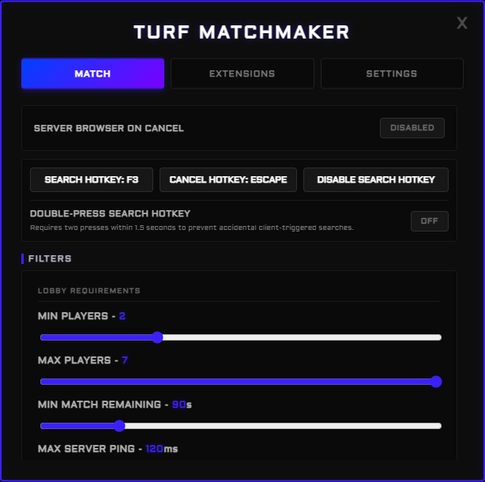

# Turf Matchmaking

A configurable Krunker lobby finder that runs as a userscript. Pick your rules once, press one key, and it joins the best lobby that matches them.

## Live demo

[Try the interactive GUI](https://piotrjeleniewicz.com/turf-demo/) in your browser. Explore filters, themes and notification previews without installing the script. Matchmaking is simulated; your game settings are not accessed.

Preview the interface

## Why Turf Matchmaking

- **Joins lobbies that are actually good.** Every candidate is rechecked with live game information right before joining, so you do not land in full, finished or empty matches.
- **Keeps hunting instead of giving up.** It searches between lobby snapshots and moves on to the next good lobby when one fills up. If everything fails, it waits in a temporary lobby while it keeps searching with your filters.
- **Stays in good rounds, leaves bad ones.** Low Player Count can find you a better lobby when yours empties out, while `Stay if:` rules (kills, KDR, time left, distance to TOP 1) keep you in a round worth finishing.
- **Your lobbies, your players.** Blacklist players you want to avoid and whitelist friends you want to stay with, straight from the Alt Player List.
- **Hands-free between matches.** Optional automatic search after a match, Double XP, reward claiming and target map hunting.
- **Updates itself in Kute.** Install once and new versions install automatically, never in the middle of a match.
- **Open and readable.** MIT-licensed, readable JavaScript you can inspect.

## Features

- Region, map, game mode, player count, time left and ping filters, with presets
- Players or ping priority, preferred map order and optional randomization between similar lobbies
- Force Player Count and Low Player Count monitoring with round protection
- Exact-name blacklist and whitelist
- Configurable search and cancel hotkeys, an optional double-press guard and a compact search status
- Customizable connection, searching and rejection notifications
- Automatic pause when Krunker's matchmaker is rate-limited or failing
- Optional custom CSS and JavaScript

## Installation

Download the files from the [latest release](https://github.com/Xcape53/TurfMatchMaking/releases/latest).

**Kute (recommended)**
1. Download `TurfMatchMaking.js` and put it in `Documents\kute\scripts`, or drop it into Kute's script manager.
2. If you used an older Turf script, disable it in Kute's script manager. Your settings are kept.
3. Reload the game.

**Other clients (Crankshaft, Glorp, KCC)**
Download `TurfMatchMaking<version>.js`, add it with your client's script system, disable any older Turf script and reload.

**Userscript managers (Tampermonkey, Violentmonkey)**
Open the [raw script](https://raw.githubusercontent.com/Xcape53/TurfMatchMaking/main/TurfMatchMaking.js) and confirm the installation.

## How to use

1. Click the on-screen **M** button to open the settings.
2. Choose your filters in the Match tab.
3. Press the search hotkey (**F3** by default) or Find Game. Press the cancel hotkey or Cancel to stop.

New users get a short guide on the first launch.

## Updates

- **Kute:** updates install automatically and start on your next reload. A window tells you when an update is installing. You can turn this off in **Settings > Script Updates**. Keep the file name `TurfMatchMaking.js` and do not edit it by hand.
- **Other clients:** an in-game notice offers the new version for download. Automatic updates for other clients are planned.

Downloads come only from this repository's releases and are checked against their SHA256 checksum before installing. See [Releases](https://github.com/Xcape53/TurfMatchMaking/releases) for what changed in each version.

## Good to know

- Krunker's lobby list can count spectators as players. Force Player Count and Low Player Count check the in-game player list to compensate.
- Displayed ping is a regional estimate, not the exact ping of each lobby.
- The script itself only contacts Krunker's public matchmaker endpoints and, for updates, this repository.

## Feedback

Bug reports and ideas are welcome in [Issues](https://github.com/Xcape53/TurfMatchMaking/issues) or by DM on Discord.

## License

MIT. See [LICENSE](LICENSE). Author: `xcape53`.

This is an unofficial community project and is not affiliated with FRVR or Krunker.
