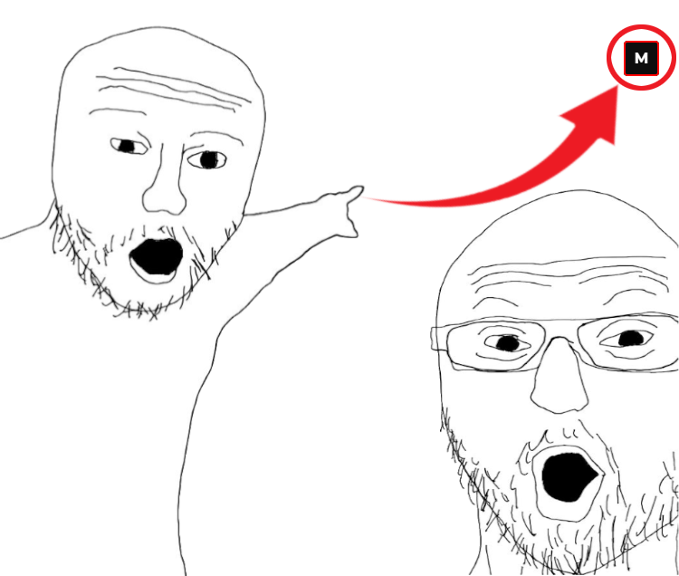
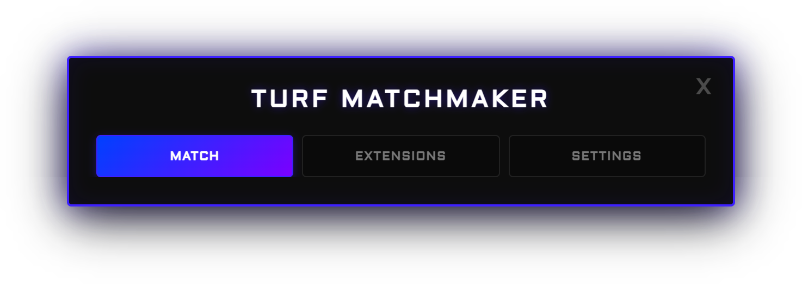
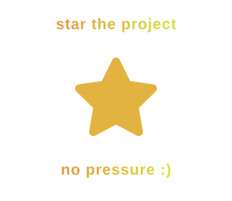

  
  
  
  
  
   
  

 

A <b>HIGHLY</b> configurable Krunker game finder userscript. <i>Pick your rules once, press one key, and you are set.</i>

<a href="https://piotrjeleniewicz.com/turf-demo/" target="_blank"><h2 align="center"><b>Click for demo</b></h2></a>

## Installation

Download the files from the [latest release](https://github.com/Xcape53/TurfMatchMaking/releases/latest).
**[Kute](https://github.com/NullDev/Kute) (recommended)**

1. Download `TurfMatchMaking.js` and put it in `Documents\kute\scripts`, or drop it into Kute's script manager.
2. If you used an older Turf script, disable it in Kute's script manager. Your settings are kept.
3. Reload the game.

**Other clients (Crankshaft, Glorp, KCC)**
Download `TurfMatchMaking<version>.js`, add it with your client's script system, disable any older Turf script and reload.

**Userscript managers (Tampermonkey, Violentmonkey)**
Open the [raw script](https://raw.githubusercontent.com/Xcape53/TurfMatchMaking/main/TurfMatchMaking.js) and confirm the installation.

## Features

| **Smart search**   | Filters by region, map, mode, players, time left and ping, saved as presets     |
| ------------------ | ------------------------------------------------------------------------------- |
| **Live checks**    | Rechecks every lobby right before joining, so you skip full or finished matches |
| **Server hunting** | Keeps scanning until something matches, including your favorite Turf Wars maps  |
| **Round control**  | Leaves lobbies that empty out, but stays when the round is worth finishing      |
| **Player lists**   | Avoid blacklisted players and stick with friends                                |
| **Hands-free**     | Searches again after each match and claims Double XP and rewards                |
| **Customizable**   | Your colors, hotkeys, notifications, CSS and JavaScript                         |
| **Auto-updates**   | New versions install automatically in Kute after **F5**                         |

## How to use

1. Click the on-screen **M** button to open the settings.
2. Choose your filters in the Match tab.
3. Press the search hotkey (**F3** by default) or Find Game. Press the cancel hotkey or Cancel to stop.

## Updates

- **[Kute](https://github.com/NullDev/Kute):** updates install automatically and start on your next reload. A window tells you when an update is installing. You can turn this off in **Settings > Script Updates**. Keep the file name `TurfMatchMaking.js` and do not edit it by hand.
- **Other clients:** an in-game notice offers the new version for download. Automatic updates for other clients are planned.

Downloads come only from this repository's releases and are checked against their SHA256 checksum before installing. See [Releases](https://github.com/Xcape53/TurfMatchMaking/releases) for what changed in each version.

 

> [!NOTE]
> ## Good to know
>
> - Krunker's lobby list can count spectators as players. Force Player Count and Low Player Count check the in-game player list to compensate.
> - Displayed ping is a regional estimate, not the exact ping of each lobby.
> - The script itself only contacts Krunker's public matchmaker endpoints and, for updates, this repository.
>
> **Did i use AI?**
> Yes, anthropic's and openai's finest

 

> [!IMPORTANT]
> ## Feedback
> Bug reports and ideas are welcome in [Issues](https://github.com/Xcape53/TurfMatchMaking/issues) or by DM on Discord.
>

## License
MIT. See [LICENSE](LICENSE). Author: `xcape53`.
This is an unofficial community project and is not affiliated with FRVR or Krunker.
